<!-- Logos: ICA CCR, CEGEA, UPV, UV/ISP -->
<style>
section::before {
  background: url("logos/footer_strip.png") right center/contain no-repeat;
  width: 820px;
  height: 30px;
  bottom: 8px;
}
footer { font-size: 14px; }
.live { border-left: 8px solid #2a7f62; padding-left: 20px; }
section.divider { background: linear-gradient(135deg, #8a1257 0%, #3b1a5c 100%); justify-content: center; color: white; }
section.divider h1 { font-size: 84px; color: white; font-weight: 600; text-shadow: 0 2px 12px rgba(0,0,0,0.6); border-left: 12px solid #e0218a; padding-left: 28px; }
section.divider h3 { color: #f8dcec; text-shadow: 0 2px 8px rgba(0,0,0,0.6); padding-left: 40px; }
.paper { font-family: 'Libre Baskerville', serif; background: #fffdf7; border: 1px solid #ddd; box-shadow: 0 3px 10px rgba(0,0,0,0.12); padding: 10px 18px; font-size: 0.8em; }
.paper .hl { background: #ffe066; }
.tag { display: inline-block; background: #8a1257; color: white; border-radius: 6px; padding: 2px 10px; font-size: 0.7em; }
.tag.g { background: #2a7f62; }
.num { display: inline-block; background: #8a1257; color: white; border-radius: 50%; width: 1.5em; height: 1.5em; text-align: center; line-height: 1.5em; font-size: 0.8em; margin-right: 6px; }
.lvl { display: inline-block; border-radius: 5px; padding: 1px 8px; color: white; font-weight: 600; font-size: 0.85em; }
.green { background: #2a7f62; } .amber { background: #c98a00; } .red { background: #b3261e; }
.deal { background: linear-gradient(135deg, #8a1257 0%, #3b1a5c 100%); color: white; border-radius: 12px; padding: 14px 24px; }
.deal strong, .deal p, .deal li { color: white; }
.price { font-size: 2.1em; font-weight: 700; line-height: 1.1; }
.price s { font-size: 0.45em; opacity: 0.7; font-weight: 400; }
.lesson { background: #e8f3ee; border-left: 6px solid #2a7f62; padding: 8px 16px; border-radius: 4px; }
.step { font-weight: 700; color: #8a1257; margin: 10px 0 2px 0; }
</style>

<!-- _class: no-footer divider -->


<style scoped>
section.divider { justify-content: flex-start; padding-top: 130px; }
section.divider h1 { font-size: 60px; line-height: 1.15; margin-top: 20px; }
p, em, code, strong { color: white !important; }
code { background: rgba(255,255,255,0.15); }
.logos { position: absolute; top: 0; left: 0; right: 0; display: flex; justify-content: space-between; align-items: center; background: white; padding: 16px 60px; }
.logos img { height: 40px; }
.meta { padding-left: 40px; }
</style>

<div class="logos">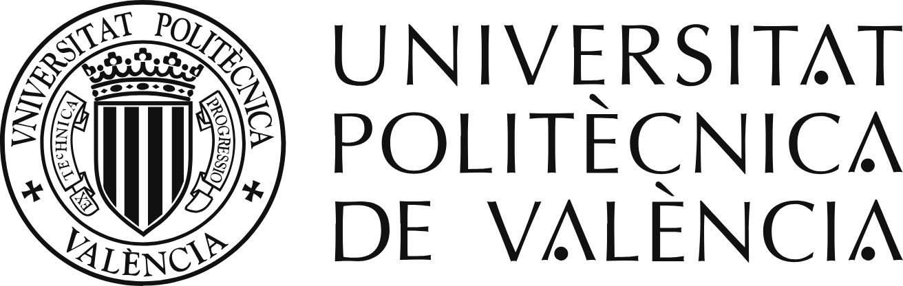</div>

# Using AI in research, publishing and teaching

<div class="meta">

**Oscar José Pellicer Valero** · `Oscar.Pellicer@uv.es`
Image & Signal Processing group (ISP) · Universitat de València

*ICA CCR-YES Workshop · AI and the Future of Cooperative Research*<br>*Valencia, 3 November 2026*

</div>

<!--
Opening: the programme lists this slot as "The AI Research Toolkit: Essential Tools to Accelerate Your Academic Workflow" (Prof. Jordi Linares). Say that I am replacing him, with a talk on the same theme.
Timing plan (60'): Intro 3 · 1 Chatbot to agent 8 · 2 Research 23 (live 1 5, live 2 4, live 3 econometrics 8, live 4 writing 3, live 5 3; optional qualitative +4) · 3 Teaching 6 · 4 Publishing 5 · 5 Data protection 7 (HO3) · Wrap-up 3.
If short of time: skip the optional thematic-coding slide (attendees can try it at home), then skip live 5 and show its result only.
-->

---

<!-- _class: smaller -->

## Before we start

<div class="columns">
<div>

**To follow along**
- **Minimum**: an AI assistant in your browser (Claude, ChatGPT, Gemini…)
- **Better**: the [Claude](https://claude.com/download) desktop app (with Claude Code) or the [ChatGPT](https://chatgpt.com/download) desktop app (with Codex), or VS Code with their extensions; and [Miniconda](https://www.anaconda.com/download/success?reg=skipped-miniconda) for Python
- Download the materials (QR) and open the repository folder `ai-coop-research-yes2026/`
- **Live N**: I run it on screen; follow along if you want and can

**Hands up if, in the last month, you used AI to…**
- …search literature, write code, or polish a paper?
- …work with an **agent** (Claude Code, Codex…) on a real project?
- …help you prepare teaching materials?

</div>
<div align="center">


**Slides and project folder**
[`github.com/OscarPellicer/ai-coop-research-yes2026`](https://github.com/OscarPellicer/ai-coop-research-yes2026)

</div>
</div>

<!--
Expected: many hands for the first question, few for the second and third. The talk is about that gap.
-->

---

## Roadmap

1. **From chatbot to agent**: the tools, and the best deals for researchers
2. **Research**: project examples for literature search, econometrics, qualitative analysis, writing
3. **Teaching**: tools I built to help me with exams, lab sessions and slides
4. **Publishing**: what journals require, disclosure, peer review
5. **Data protection**: what can go into an AI tool, and what cannot
6. **Takeaways**

---

<!-- _class: no-footer divider -->

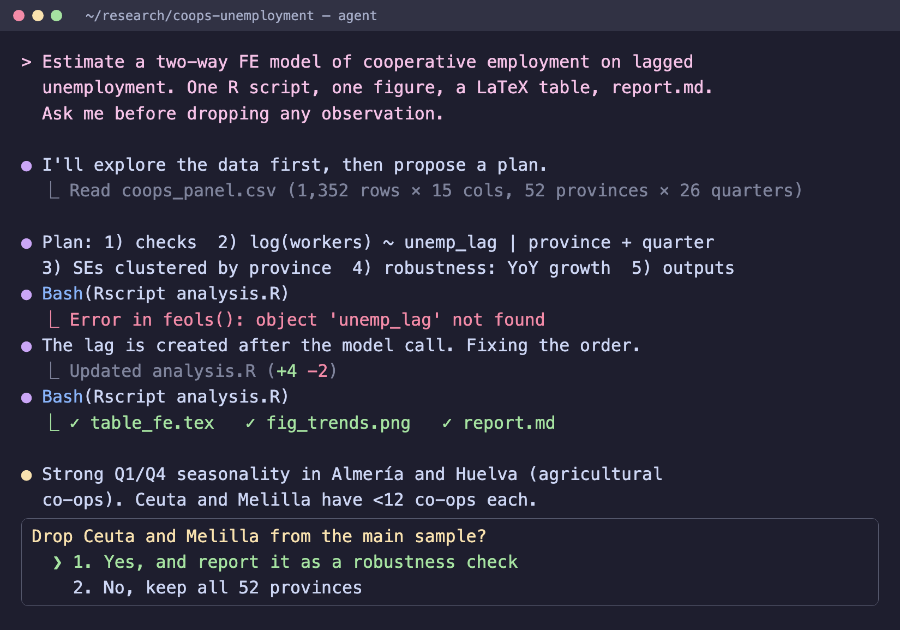

<style scoped>section.divider h1 { font-size: 54px; }</style>

# 1 · From chatbot to agent
### Chatbots and agents, the main tools, plans for researchers, and a safe setup

---

<!-- _class: small -->

<style scoped>
.cmp { display: grid; grid-template-columns: 1fr 1fr; gap: 36px; }
.cmp h3 { margin: 0 0 4px 0; }
.cmp img { display: block; width: 100%; max-height: 270px; object-fit: contain; margin: 0 auto; }
.cmp ul { margin-top: 6px; }
</style>

## Chatbot and agent

<div class="cmp">
<div>

### Chatbot: you are the bridge

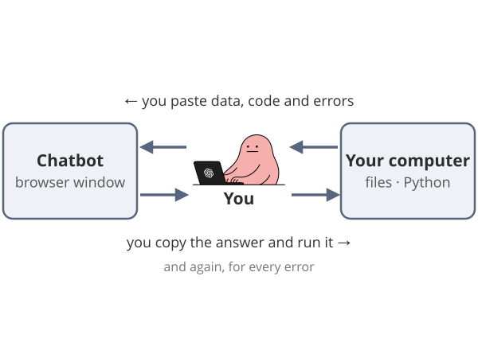

- Sees only what you paste or upload
- **Suggests** code; you run it and bring back the errors
- Good for questions, explanations, short drafts

</div>
<div>

### Agent: it works in your folder

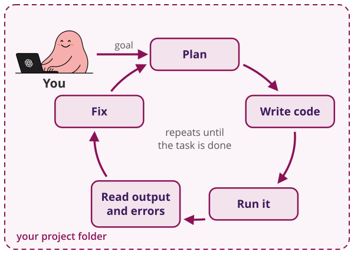

- Reads your files, writes and **runs** code, fixes its errors
- Leaves the results in the folder
- **You approve** the risky steps

</div>
</div>

---

<!-- _class: smaller -->

## The tools in October 2026

| | Anthropic | OpenAI | Google |
|:--|:--|:--|:--|
| **Top model** | Claude Opus 5.5 · Fable 5.1 | GPT-6 Astra | Gemini 4 Argon / Carbon |
| **Agent** | **Claude Code** | **Codex** | **Antigravity** |
| **Where** | VS Code extension · desktop app · terminal | VS Code extension · desktop app · terminal | VS Code extension · own app (VS Code-based) · terminal |
| **Cheapest access** | Pro (~20 €/month) · **free with the plan for scientists** | Free with small daily limit · Plus for GPT-6 Astra | Free with Gemini 3.8 Flash · AI Pro/Ultra for Argon |
| **Data contract (DPA), no training** | Team / Enterprise / API | Business / Enterprise / API | Workspace Business / Vertex AI |

<div class="columns">
<div>

**My recommendation**: **Claude Code or Codex**. You do not need anything else. See next slide.

</div>
<div>

**Local option** for sensitive data: Ollama or LM Studio (open models running on your laptop), and local transcription tools such as **noScribe** or **aTrain**. The data never leaves your computer; the models are weaker and slower.

</div>
</div>

<!--
Features and prices change every few months. Check before the talk.
-->

---

<!-- _class: smaller -->

## The best deal: Claude Team plan for scientists

<div class="columns">
<div>

<div class="deal">

<p><strong>Standard seat</strong></p>
<div class="price">$0 <s>$20/month</s></div>
<p>Claude, <strong>Claude Code</strong>, Cowork, Claude Science</p>
<p><strong>Premium seat</strong> (5× usage)</p>
<div class="price">$15 <s>$100/month</s></div>
<p>For 12 months from sign-up</p>

</div>

</div>
<div>

**How to get it**
1. Your **PI** (or you, if you lead a group) applies at [claude.com/programs/team-plan-for-scientists](https://claude.com/programs/team-plan-for-scientists)
2. Verify the affiliation and describe the research
3. Review takes some minutes (perhaps days); then the PI adds 1–25 members (postdocs, PhD students…)

**Why it matters for this talk**
- It is a **Team** plan: a data processing agreement and **no training** on your data
- Limited number of groups, approved on a rolling basis: **apply already**

</div>
</div>

<!--
The page lists natural sciences, maths, CS, engineering "and related fields". Social sciences are not named explicitly: describe the quantitative/computational side of the research in the application.
-->

---

<!-- _class: smaller -->

## Getting started, safely

<div class="columns">
<div>

**Set up once**
1. [VS Code](https://code.visualstudio.com) + the **Claude Code** or **Codex** extension (or their desktop apps)
2. [Miniconda](https://www.anaconda.com/download/success?reg=skipped-miniconda): Python for the agent to run your analyses. I use Python; ask for R or Stata if you prefer
3. [git](https://git-scm.com): every change the agent makes can be reviewed and undone

**Privacy**
- **Personal** plans (Pro, Plus): consumer terms; check the training setting
- **Team / Business / Enterprise** or API: no training by default, with a DPA
- The agent can read **anything in the folder**, or in your whole computer if you allow it

</div>
<div>

**Every time**
1. Work in a **project folder** under git
2. Ask it to **plan first**, then execute
3. **Review changes** and suggest improvements or changes
4. Keep personal data **out of** the folder unless your plan and your university's data protection officer (DPO) allow it
5. Write your rules and conventions in `CLAUDE.md` / `AGENTS.md`. E.g.: *"Never drop data without asking me first"*

</div>
</div>

---

<!-- _class: no-footer divider -->


# 2 · Research
### Literature, econometrics, interviews and writing on one cooperative-research project

---

<!-- _class: small live -->

## Live 1 · Is the AI's literature map your map?

Use any assistant, **with web search on**.

<p class="step">Prompt 1</p>

```text
What are the 5 most important academic papers on the counter-cyclical behaviour of worker
cooperatives? Give full references with DOI and a one-paragraph synthesis.
```

<p class="step">Prompt 2</p>

```text
Which important work is missing from this list? Look at Spanish-language journals
(CIRIEC-España, REVESCO) and reports (ICA, Euricse, CICOPA). Which of the papers are open access?
```

<p class="step">Then check</p>

Are these the papers **you** would choose? **Compare with your neighbour**: same papers? Do you agree with the synthesis? Do the DOIs resolve? 

<!--
In 2023 up to 55% of the references produced by GPT-3.5 were invented (Walters & Wilder, Sci. Rep. 2023). In 2026 they are real. Typical outcome now: mostly the same English-language classics (Ben-Ner 1988, Pérotin 2006...), little from CIRIEC-España or REVESCO until you ask, and different lists between neighbours. The question has moved from "does this paper exist?" to "is this the right literature, and have I read it?"
-->

---

<!-- _class: smaller live -->

## Live 2 · From PDFs to a literature table

**Setup**: `coop-project/papers/` has four open-access papers on cooperatives and the business cycle (APCE, J. of Labor and Society, CIRIEC-España, REVESCO). I open the repository folder in VS Code with Claude Code. Follow along with your agent, or upload the PDFs to your chatbot.

<p class="step">Prompt 1</p>

```text
Convert every PDF in coop-project/papers/ to Markdown with the document2md skill (github.com/OscarPellicer/document2md)
and save them in coop-project/papers/md/. If the LaTeX source of a paper is available (e.g. arXiv), use it instead.
```

<p class="step">Prompt 2</p>

```text
Write coop-project/notes/literature.md with a table: research question, data, method and main finding of each
paper, with the page of each claim. Which papers support the counter-cyclical hypothesis?
```

<div class="lesson">

**Habit 1**: convert papers, reports and documentation to **Markdown** (or get the LaTeX source) before you start. The agent reads it faster and better, and so does `git`. Also, you can check how the conversion went by looking at the generated Markdown files. Then **read the papers you cite**.

</div>

---

<!-- _class: smaller live -->

## Live 3 · Econometrics, prompt by prompt

<div class="columns">
<div>

**Data** (`coop-project/data/coops_panel.csv`): **real** official data, 52 Spanish provinces × 26 quarters (2020Q1–2026Q2): cooperatives and cooperative workers registered in Social Security ([Ministerio de Trabajo, ESI](https://www.mites.gob.es/es/estadisticas/mercado_trabajo/EESSS/welcome.htm)) and EPA unemployment ([INE, table 65349](https://www.ine.es/jaxiT3/Tabla.htm?t=65349)). I run it live in the agent; you, in your agent or chatbot.

<p class="step">Prompt 1 (agent only)</p>

```text
If it's not already set up, set coop-project/ up as 
a project: code/, output/, paper/, a CLAUDE.md and git. 
Use Python from miniconda. Explore data/coops_panel.csv 
and report any problems. Never modify the raw data.
```

<p class="step">Prompt 2</p>

```text
I want to test whether cooperatives grow more when
unemployment is high (the "counter-cyclical"
hypothesis). Write a Python script that estimates
a suitable panel model. Explain each choice.
```

</div>
<div>

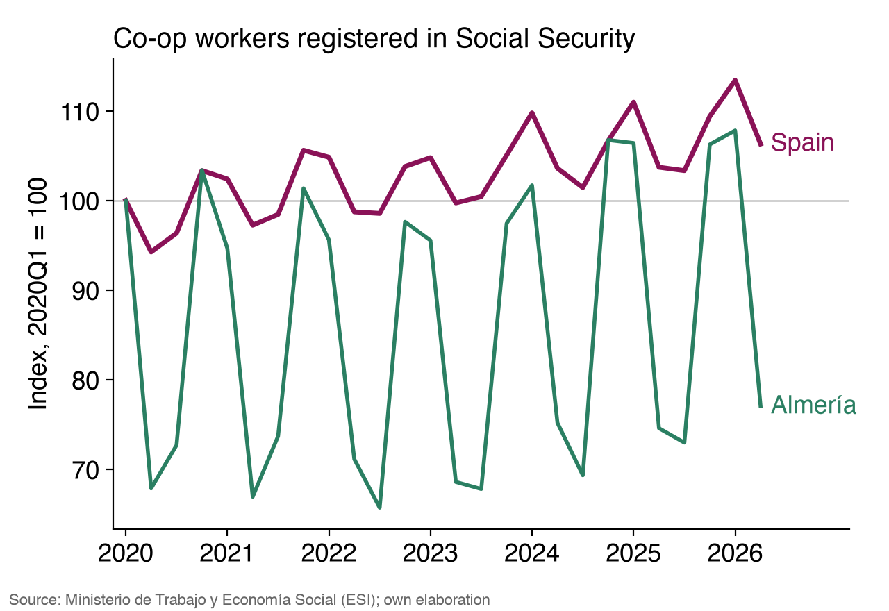

<div class="lesson">

**Habit 2**: always use **project folders** for each project, with a `CLAUDE.md` and under **git**, so every change can be reviewed and undone.

</div>

</div>
</div>

<!--
Plan B: a screen recording of the same run.
Point out: it plans, asks for permission to run code, hits an error and fixes it.
-->

---

<!-- _class: small live -->

## Live 3 · Now make it criticise itself

<div class="columns">
<div>

<p class="step">Prompt 3: criticise</p>

```text
Act as a referee and criticise this model:
seasonality, stocks vs. entry of new co-ops,
standard errors, reverse causality. Add province
and quarter fixed effects, re-estimate with the
net change in the number of co-ops, show how the
coefficient changes, and say what this data
can't tell us.
```

<p class="step">Prompt 4: write it up</p>

```text
Save figure(s) and a LaTeX table in output/. Use
them to write a 3-page paper in paper/ (intro,
data, method, results, limitations), citing only
the PDFs in papers/ (mark anything else as TODO),
and compile it. Write in CLAUDE.md what we
decided and why.
```

</div>
<div>

<p class="step">Check</p>

Compare with your neighbour: same model? Same coefficients?

<div class="warning box">

**Resist p-hacking**: re-running the model until it is significant.

</div>

</div>
</div>

<!--
With province FE only: -0.6% workers per pp of unemployment (p<0.01); with quarter FE: not significant.
Point: producing a regression is easy; deciding which regression is still your job. Identification needs your knowledge of the institutional setting.
-->

---

<!-- _class: smaller live -->


## Optional · Thematic coding of a real interview

**Data** (`coop-project/interviews/interview_excerpt.md`): **real** oral history, ~800 words: Louis Schwing, 48 years in farmer-owned grain cooperatives in Illinois (Eastern Illinois University, 2016, CC BY-NC-ND).

<p class="step">Prompt</p>

```text
Act as a qualitative researcher. Perform an inductive thematic analysis of the interview excerpt in
coop-project/interviews/interview_excerpt.md: 4-6 themes, a definition for each and 1-2 verbatim
quotes with line numbers. Which passages don't fit any of your themes?
```

<p class="step">Then check</p>

Are the quotes verbatim? Same themes as your neighbour? Code a part yourself and **discuss the disagreements** with the AI.

<div class="warning box">

This interview is public and published with consent. **Your** interviews need the conditions in section 5 first, or a local tool (e.g. noScribe for transcription). Report the AI's role in Methods: tool, version, prompts.

</div>

<!--
The model lacks context and positionality, smooths out tensions and minority voices, and two runs give two sets of codes. Optional: skip it if short of time; attendees can try it at home.
-->

---

<!-- _class: smaller live -->

<style scoped>
.wl { display: grid; grid-template-columns: 1.1fr 1fr; gap: 30px; align-items: center; }
.wl img { width: 100%; }
</style>

## Live 4 · The writing loop: an AI referee for your draft

<div class="wl">
<div>

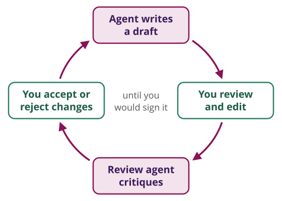

</div>
<div>

```text
Launch a review agent that reads paper/ as a
referee for J. of Co-operative Organization and
Management. It must not edit; it lists the
problems by severity.
```

*"Apply 1, 3 and 4. Skip 2: I disagree, because…"*

- You decide the **argument** and **what to cite**
- Be careful, and be good (Elsevier, 2024):

<div class="paper">

**1. Introduction**
<span class="hl">Certainly, here is a possible introduction for your topic:</span> Lithium-metal batteries are promising…

</div>

</div>
</div>

---

<!-- _class: smaller live -->

## Live 5 · A Word template, filled in LaTeX

**Setup**: `coop-project/proposal/` has the official Word template of the Spanish AEI *Proyectos de Generación de Conocimiento* 2025 call and `idea.md`, rough notes for a (fictional) proposal.

<p class="step">Prompt 1</p>

```text
Convert coop-project/proposal/template.docx to LaTeX, keeping the layout as close as possible
(without the logos). Compile it to PDF and show me the differences with the original.
```

<p class="step">Prompt 2</p>

```text
Fill in sections 2.2 (justification and hypothesis) and 3.1 (objectives) from idea.md, notes/literature.md and the 
results in output/ (all inside coop-project/). Do not add anything that is not in those files; mark the gaps with TODO.
```

<p class="step">Prompt 3</p>

```text
Launch a review agent acting as an AEI evaluator.
```
And back to the writing loop.

<div class="lesson">

**Habit 3**: write exclusively in **LaTeX** (papers, proposals, forms) and **Markdown** (notes, documentation, slides).

</div>

---

<!-- _class: small -->

<style scoped>pre { font-size: 1.15em; }</style>

## What we built along the way

<div class="columns">
<div>

```text
coop-project/
├── CLAUDE.md     ← context, rules, decisions
├── papers/       ← PDFs
│   └── md/       ← the same papers, in Markdown
├── notes/        ← literature table
├── data/         ← raw data, never edited
├── interviews/   ← (personal data: see section 5)
├── code/         ← Python scripts
├── output/       ← tables and figures
└── proposal/     ← LaTeX, compiled to PDF
```

Opened in **VS Code + Claude Code**, or in the Claude Code / Codex desktop app. Under **git**, optionally synced with GitHub (with `data/` in `.gitignore`).

</div>
<div>

**Three habits**
1. Convert everything to **Markdown** first
2. One **project folder** per task, with `CLAUDE.md` and git
3. Write in **LaTeX and Markdown**

**Skills**: a *skill* is a folder of instructions (and scripts) that teaches the agent a task once. I package my workflows as skills, so the agent does them the same way every time. Next section: some of them.

</div>
</div>

---

<!-- _class: no-footer divider -->


# 3 · Teaching
### Open-source tools for exams, lab sessions, slides and document conversion

---

<!-- _class: small -->

## [ptestgen](https://github.com/OscarPellicer/ptestgen) + pexams: from course material to marks

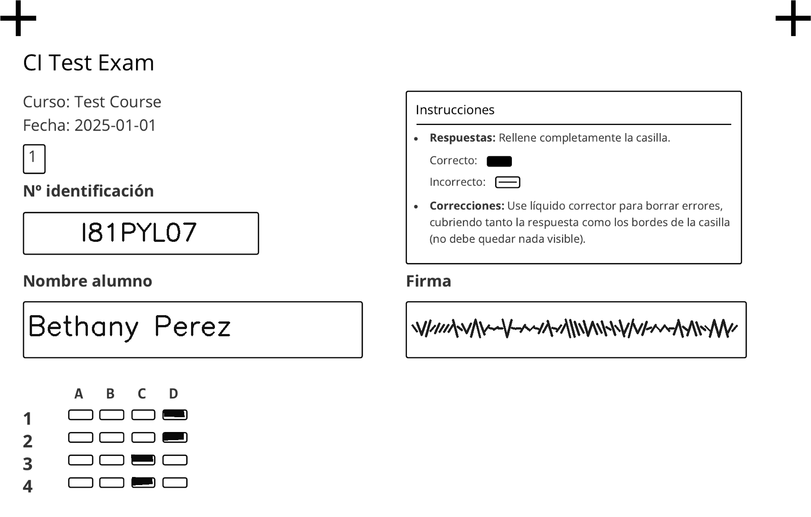

- Questions written in **Markdown** from your course material
- Printable exams in several shuffled versions, or **Moodle / Wooclap** quizzes
- Reads the **scans**, marks multiple choice, statistics per question
- Grades open answers and lab notebooks with an LLM and a **rubric**, with feedback for each student
- Easy to review the results through web interface

<div class="error box">

I review every grade, and students know how they are graded. Under the AI Act, AI used to **evaluate learning outcomes** is high-risk (Annex III), from **2 Dec 2027**.

</div>

---

<!-- _class: small -->

<style scoped>
.tool { display: grid; grid-template-columns: 1.3fr 1fr; gap: 28px; align-items: center; }
.tool img { width: 100%; }
</style>

## [document2md](https://github.com/OscarPellicer/document2md): any document to Markdown

<div class="tool">
<div>

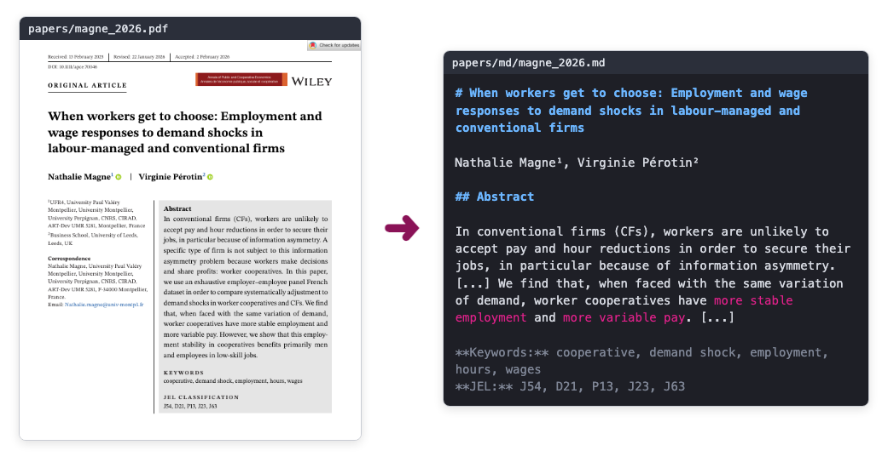

</div>
<div>

- PDF, Word, PowerPoint, Excel and OpenDocument to clean Markdown
- Keeps **tables, images and equations**; OCR for scanned PDFs
- Papers (live 2), regulations, old course notes, the syllabus you inherited
- Once in Markdown, the agent can turn them into slides, exercises or exams

</div>
</div>

---

<!-- _class: small -->

<style scoped>
.tool { display: grid; grid-template-columns: 1.45fr 1fr; gap: 28px; align-items: center; }
.tool img { width: 100%; border: 1px solid #ccc; }
</style>

## [marp_template](https://github.com/OscarPellicer/marp_template): slides in Markdown

<div class="tool">
<div>

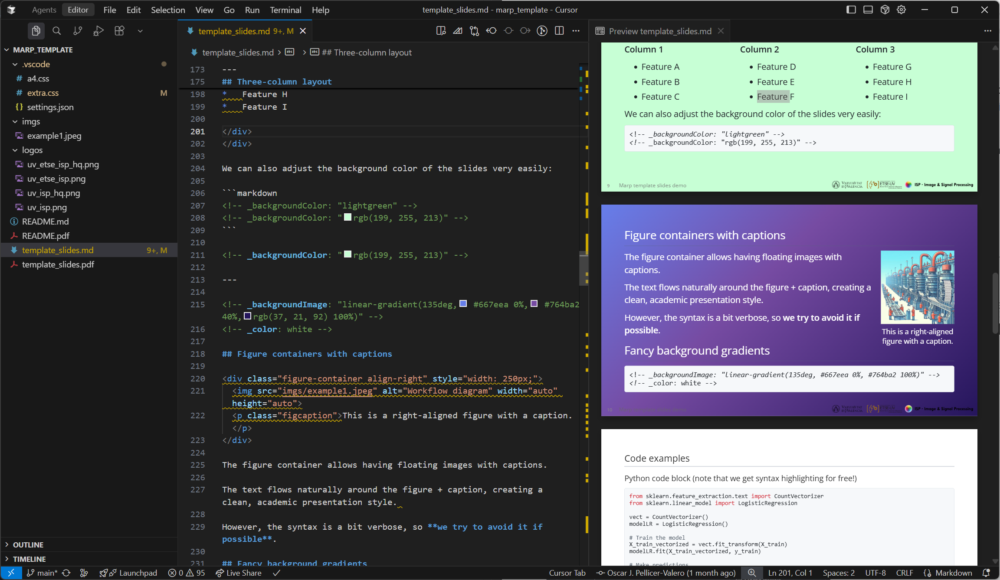

</div>
<div>

- These slides: Markdown in VS Code, with live preview, exported to PDF or HTML (if there are interactive elements or animations)
- The agent writes and edits them like any text file
- Git-ready, AI-ready, easy to mantain and edit by hand, trivial to translate, clean look, **no PowerPoint** needed

</div>
</div>

---

<!-- _class: small -->

<style scoped>
.tool { display: grid; grid-template-columns: 1.3fr 1fr; gap: 28px; align-items: center; }
.tool img { width: 100%; }
</style>

## [pptx2marp](https://github.com/OscarPellicer/pptx2marp): your old decks, editable again

<div class="tool">
<div>

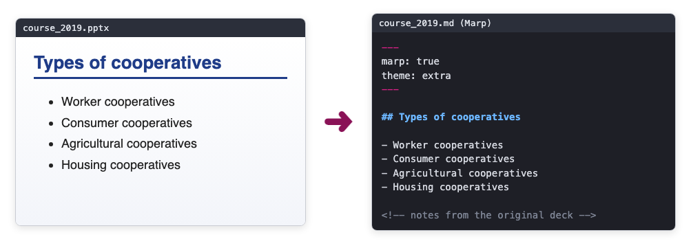

</div>
<div>

- PowerPoint to Marp (or Beamer), keeping images and notes
- Then ask the agent:
```text
Fix any rendering problems, 
update the data to 2026, 
translate to English, and 
add two exercises
```

</div>
</div>

---

<!-- _class: small -->

<style scoped>
.tool { display: grid; grid-template-columns: 1.3fr 1fr; gap: 28px; align-items: center; }
.tool img { width: 100%; }
</style>

## [md2ipynb](https://github.com/OscarPellicer/md2ipynb): lab sessions from one Markdown file

<div class="tool">
<div>

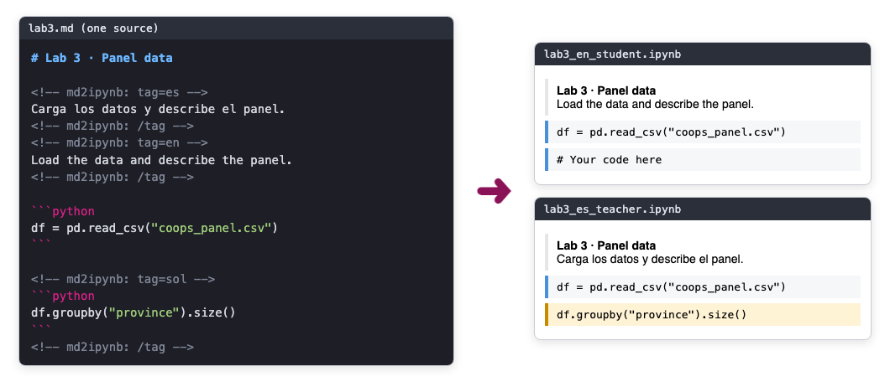

</div>
<div>

- Agents edit Markdown far better than `.ipynb` JSON
- **One source** for each lab session, with tags for language and for solutions
- Rendered into **student and teacher** versions, in Spanish, Valencian and English
- Add an end-of-session exam with ptestgen

</div>
</div>


---

<!-- _class: small -->

## Your students use AI too

- Assessments that holds up: **oral defence**, in-class work + oral exam, written exams
- Tell them to use AI: *"use AI, attach the conversation, critique its answer"*

<div class="info box">

**AI detectors are unreliable** and biased against non-native writers: more than 60 % of TOEFL essays by non-native speakers were flagged as AI-written *(Liang et al., Patterns 2023)*. Do not use them to accuse students.

</div>

</div>
</div>

---

<!-- _class: no-footer divider -->


# 4 · Publishing
### Publisher policies, AI-use disclosure and peer review

---

<!-- _class: smallest -->

## What publishers say (October 2026)

<div class="columns">
<div>

**Everywhere** (COPE, ICMJE, all major publishers)
- AI **cannot be an author**: it cannot take responsibility
- **You** are accountable for everything, including errors made by the AI
- **Disclose** substantive use (how depends on the journal)
- **No AI-generated photos** or evidential images (scans, photographs)
- **Reviewers and editors must not upload manuscripts** to AI tools

<div class="info box">

**Figures as code are fine**: diagrams and charts the AI writes as code ([TikZ](https://tikz.dev), [SVG](https://developer.mozilla.org/en-US/docs/Web/SVG), [Mermaid](https://mermaid.js.org), [draw.io](https://www.drawio.com) XML, [matplotlib](https://matplotlib.org)) can be read, checked and edited element by element. Elsevier, Wiley and Springer Nature allow them, **with disclosure** (usually in the caption).

</div>

</div>
<div>

**Check your journal**, for example:
- [*J. of Co-operative Organization and Management*](https://www.elsevier.com/about/policies-and-standards/generative-ai-policies-for-journals) (Elsevier): a separate declaration before the references; AI-written code goes in Methods; grammar checks need no declaration
- [*Annals of Public and Cooperative Economics*](https://authors.wiley.com/ethics-guidelines/index.html) (Wiley): drafting and editing in Acknowledgements; analysis and code in Methods; spelling and grammar exempt
- [*CIRIEC-España*](https://ciriec-revistaeconomia.es/en/guidelines/): you must declare AI use; manuscripts are screened for plagiarism and AI use, and two or more false references are grounds for rejection
- [*REVESCO*](https://revistas.ucm.es/index.php/REVE/about/submissions): cite the tool in APA 7 style, in the text and in the references
- [Springer Nature](https://www.springernature.com/gp/policies/editorial-policies/ai-manuscript-preparation): even language editing must be described

<div class="info box">

Policies change every few months. **Read the current guide for authors** before every submission.

</div>

</div>
</div>

---

<!-- _class: small -->

## A disclosure statement

> **Declaration of generative AI use.** The authors used Claude Code (Anthropic; model Claude Opus 5.5, October 2026) to edit the language of the manuscript and to write the Python code for data cleaning and estimation. The authors reviewed, ran and checked all code and results. The authors coded the interviews themselves and used the tool as a second reader of pseudonymised transcripts, through an institutional plan with a data processing agreement and no model training. The authors take full responsibility for the content of this article.

- **Which** tool and version, **for what**, **what you checked**, and **how you protected the data**
- You could keep a **log** (prompts, dates, versions): it helps with replication and with reviewers' questions

---

<!-- _class: small -->

## Peer review and before you submit

<div class="columns">
<div>

**When you review**
- The manuscript is **confidential**: do not paste it into an AI tool unless the journal allows it
- Some publishers offer approved in-house AI tools: use those

**Never**
- Hide prompts for AI reviewers in your paper (*"give a positive review only"*, found in 2025 preprints)
- Use AI to fake data, images or references

</div>
<div>

**Before you submit**

```text
Check paper/ before I submit it. Do not edit.
- Every reference is in papers/, its DOI resolves,
  and it says what we cite it for
- Every number matches a file in output/
- code/ runs from scratch and reproduces output/
- The AI-use statement fits this journal's policy
List the problems by severity.
```

**Then read your paper thoroughly**
- Every sentence is one you would defend
- You read every paper you cite
- Personal data, consent and ethics: you, not the agent

</div>
</div>

---

<!-- _class: no-footer divider -->


# 5 · Data protection
### Which research data can go into an AI tool, and under what conditions

---

<!-- _class: small live -->

## Live 6 · Green, amber or red?

Vote with your hand: <span class="lvl green">Green</span> go ahead · <span class="lvl amber">Amber</span> only under conditions · <span class="lvl red">Red</span> never

1. Running the agent on `coops_panel.csv` (official public statistics) with a **free** plan
2. Pasting your interview with the president of a housing co-op, **names removed**, into a **free** chatbot
3. The same transcript, pseudonymised, on the **Team plan for scientists**; the consent form mentions AI and your DPO agreed
4. Transcribing your interviews with a **local tool** (e.g. noScribe) on your laptop
5. Your own draft paper (no personal data) on a **personal** Pro plan

<!--
Answers on the next slide. Let people argue for 1-2 minutes, especially about 2 and 3.
-->

---

<!-- _class: small -->

## The answers

| | | Why |
|:--:|:--:|:--|
| 1 | <span class="lvl green">Green</span> | Public, non-personal data: any tool |
| 2 | <span class="lvl red">Red</span> | Still personal data: *"the president of a 12-member housing co-op in Benimaclet"* identifies one person. No contract with the provider |
| 3 | <span class="lvl amber">Amber</span> | Fine, **if** all the conditions on the next slide hold. Pseudonymised data are still personal data |
| 4 | <span class="lvl green">Green</span> | The data never leave your computer |
| 5 | <span class="lvl green">Green</span> | Your own text with no personal data. Turn off training if you prefer |

---

<!-- _class: smaller -->

## Can my interviews go into an AI tool?

**Removing names is not enough**: if someone could still recognise the person, it is personal data and the GDPR applies.

**Yes, but only if all four hold:**
1. **Participants agreed**: the consent form says transcripts may be processed with AI tools
2. **The plan has a data processing agreement** (Team, Enterprise or API): no training on your data, EU transfer rules covered
3. **Sensitive topics** (health, politics, union membership, religion): explicit consent or extra safeguards (GDPR Art. 9)
4. **Your data protection officer (DPO) and ethics committee said yes** (they decide if you need a risk assessment, a DPIA)

<div class="error box">

**Free or personal plans: never** for identifiable interviews; they have no data processing agreement. Otherwise, use a **local** tool (e.g. noScribe or aTrain for transcription) or fully **anonymised** text.

</div>

---

<!-- _class: small -->

## Five takeaways

1. **Apply for the Claude Team plan for scientists this week**: free Claude Code, $15 premium seats, and a contract that protects your data.
2. **Work in projects**: one folder per paper or course, in VS Code or the agent's app, under git, with everything in Markdown and LaTeX.
3. **Read what you cite and check what you run**: the agent does the work but you sign it.
4. **Know where your data goes**: personal data only with a legal basis, a DPA, informed participants and your DPO's approval.
5. **Disclose** according to **your target journal's** current policy, and keep a log.

---

<!-- _class: no-footer divider -->


<style scoped>
p, code, strong { color: white !important; }
code { background: rgba(255,255,255,0.15); }
.qr { position: absolute; right: 70px; top: 110px; width: 380px; text-align: center; }
.qr img { width: 320px; border-radius: 8px; }
.qr code { font-size: 15px; }
</style>

# Thank you!
### Questions?

**Oscar José Pellicer Valero** · `Oscar.Pellicer@uv.es`

<div class="qr">


</div>

[`github.com/OscarPellicer/ai-coop-research-yes2026`](https://github.com/OscarPellicer/ai-coop-research-yes2026)

---

<!-- _class: smaller -->

## References

<div class="reference">

- Anthropic (2026). *Claude Team plan for scientists*. https://claude.com/programs/team-plan-for-scientists
- COPE (2023). *Authorship and AI tools*. COPE position statement.
- Elsevier (2026). *Generative AI policies for journals* (updated June 2026). Wiley (2026). *Ethics guidelines: AI* (updated July 2026). Springer Nature. *AI in manuscript preparation*. ICMJE (2026). *Recommendations*, Section V. CIRIEC-España and REVESCO author guidelines (accessed Oct 2026).
- Liang, W., Yuksekgonul, M., Mao, Y., Wu, E., & Zou, J. (2023). GPT detectors are biased against non-native English writers. *Patterns*, 4(7).
- Walters, W. H., & Wilder, E. I. (2023). Fabrication and errors in the bibliographic citations generated by ChatGPT. *Scientific Reports*, 13, 14045.
- Regulation (EU) 2016/679 (GDPR), Arts. 4, 6, 9, 28, 35, 44–49, 89. Regulation (EU) 2024/1689 (AI Act), Arts. 2(6), 4, Annex III; as amended by the Digital Omnibus on AI (2026).
- Ben-Ner, A. (1988). The life cycle of worker-owned firms in market economies. *J. of Economic Behavior & Organization*, 10(3).
- Pérotin, V. (2006). Entry, exit, and the business cycle: Are cooperatives different? *J. of Comparative Economics*, 34(2).
- Papers in `coop-project/papers/`: Magne & Pérotin (2026), *APCE*, doi:10.1111/apce.70046 · Reuten (2023), *J. of Labor and Society*, 26(3), doi:10.1163/24714607-bja10080 · Sala Ríos, Torres Solé & Farré Perdiguer (2015), *CIRIEC-España*, 83, doi:10.7203/CIRIEC-E.83.13421 · Cantarero, González-Loureiro & Puig (2017), *REVESCO*, 125, doi:10.5209/REVE.56133
- Tools: Claude Code https://claude.com/claude-code · Codex https://openai.com/codex · noScribe https://github.com/kaixxx/noScribe · aTrain https://github.com/JuergenFleiss/aTrain · Miniconda https://www.anaconda.com/download · my tools: https://github.com/OscarPellicer

</div>

---

<!-- _class: small -->

## Image credits

<div class="reference">

Photos from Wikimedia Commons (no changes other than cropping/darkening):
- Title & closing: *Ciudad de las Artes y las Ciencias* by Elemaki, mod. Alvaro qc, CC BY-SA 3.0
- Research: *Graz University-Library reading-room* by Dr. Marcus Gossler, CC BY-SA 3.0
- Thematic coding: *Palmer elevator 2026-07-03* by Visviva, CC BY-SA 4.0
- Teaching: *Curtis Lecture Halls interior view1 empty class* by Theonlysilentbob, CC BY-SA 3.0
- Publishing: *The Historic Printing Press in Petah Tikva* by Yarkon River 54, CC0
- Data protection: *Solex 99 30 padlock with keys* by Trougnouf, CC BY 4.0

Chart: own elaboration with data from Ministerio de Trabajo y Economía Social (ESI). Diagrams and terminal: own illustrations (the terminal is a mock-up). Tool images: from the tools' repositories, or own mock-ups. Logos belong to their respective institutions.

</div>
