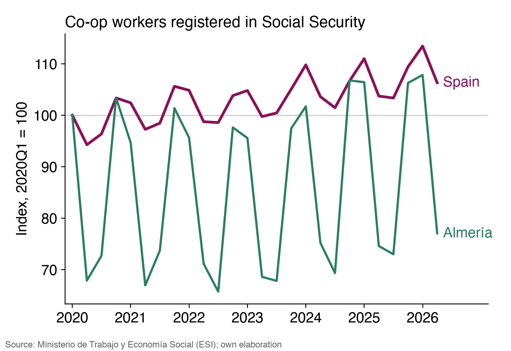
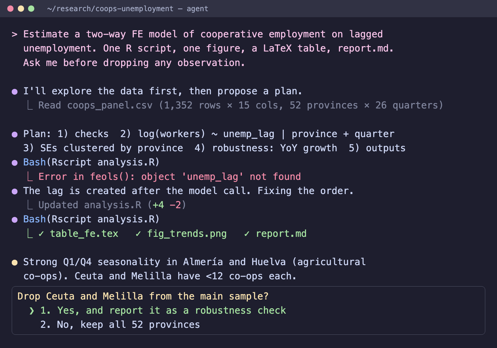

<!-- Logos: ICA CCR (left) + UV/ISP (right) -->
<style>
section::before {
  background: url("logos/ica_ccr.png") left center/contain no-repeat,
              url("logos/uv_isp.png") right center/contain no-repeat;
  width: 700px;
  height: 34px;
  bottom: 6px;
}
footer { font-size: 14px; }
.hands-on { border-left: 8px solid #8a1257; padding-left: 20px; }
section.divider { background: linear-gradient(135deg, #8a1257 0%, #3b1a5c 100%); justify-content: center; color: white; }
section.divider h1 { font-size: 84px; color: white; font-weight: 600; text-shadow: 0 2px 12px rgba(0,0,0,0.6); border-left: 12px solid #e0218a; padding-left: 28px; }
section.divider h3 { color: #f8dcec; text-shadow: 0 2px 8px rgba(0,0,0,0.6); padding-left: 40px; }
section.title { font-size: 24px; }
section.title h1 { font-size: 46px; font-weight: 600; color: #3b1a5c; margin-bottom: 0; }
section.title h3 { color: #8a1257; margin-top: 4px; }
.flow { display: flex; flex-wrap: wrap; gap: 6px; align-items: center; font-size: 0.75em; margin-top: 10px; }
.flow span { background: #f3e3ec; border: 1px solid #8a1257; border-radius: 6px; padding: 2px 8px; }
.flow b { color: #8a1257; }
.paper { font-family: 'Libre Baskerville', serif; background: #fffdf7; border: 1px solid #ddd; box-shadow: 0 3px 10px rgba(0,0,0,0.12); padding: 14px 20px; font-size: 0.82em; }
.paper .hl { background: #ffe066; }
.tag { display: inline-block; background: #8a1257; color: white; border-radius: 6px; padding: 2px 10px; font-size: 0.7em; }
.num { display: inline-block; background: #8a1257; color: white; border-radius: 50%; width: 1.5em; height: 1.5em; text-align: center; line-height: 1.5em; font-size: 0.8em; margin-right: 6px; }
.lvl { display: inline-block; border-radius: 5px; padding: 1px 8px; color: white; font-weight: 600; font-size: 0.85em; }
.green { background: #2a7f62; } .amber { background: #c98a00; } .red { background: #b3261e; }
.deal { background: linear-gradient(135deg, #8a1257 0%, #3b1a5c 100%); color: white; border-radius: 12px; padding: 14px 24px; }
.deal strong, .deal p, .deal li { color: white; }
.price { font-size: 2.1em; font-weight: 700; line-height: 1.1; }
.price s { font-size: 0.45em; opacity: 0.7; font-weight: 400; }
</style>

<!-- _class: no-footer title -->


# Using AI in research, publishing and teaching
### …without getting burned

**Oscar José Pellicer Valero**
`Oscar.Pellicer@uv.es`
Image & Signal Processing group (ISP) · Universitat de València


*YES Workshop · ICA CCR Europe 2026 · Valencia, 3 Nov 2026*

<!--
Timing plan (60'): Intro 5 · Tools 10 · Research + HO1/HO2 18 · Agents & my tools 7 · Publishing 6 · Data protection + HO3 8 · Teaching 3 · Wrap-up 3.
-->

---

<!-- _class: small -->

## Before we start

<div class="columns">
<div>

**Get ready (30 s)**
1. Open an AI assistant on your laptop or phone (Claude, ChatGPT, Gemini…)
2. Scan the QR to get the materials
3. Sit next to someone: we will compare results

**Three short hands-on blocks** (about 5 min each)

<span class="num">1</span> Is the AI's literature map your map?
<span class="num">2</span> Econometrics **or** qualitative coding
<span class="num">3</span> Pseudonymise before you upload

</div>
<div align="center">


**Slides, data, interview, prompts, checklist**
`github.com/OscarPellicer/ai-coop-research-yes2026`

</div>
</div>

---

## Quick show of hands

Who has, **in the last month**, used a generative AI tool to…

1. …search or summarise literature?
2. …write or debug **code** (R, Stata, Python)?
3. …polish the **English** of a paper?
4. …analyse **interview transcripts** or survey answers?
5. …prepare **teaching** materials?

And now:

6. Who has used an **agent** (Claude Code, Codex…) on a real project?
7. Who knows **where the data goes** when you paste a transcript into a chatbot?

<!--
Expected: many hands for 1-3, few for 6-7. The talk is about that gap.
-->

---

<!-- _class: smaller -->

## What changed since 2023

<div class="columns">
<div>

**2023–2024: the famous failures**
- Up to **55 %** of the references produced by GPT‑3.5 were invented *(Walters & Wilder, Sci. Rep. 2023)*
- A 2024 Elsevier paper went to print with this first line:

<div class="paper">

**1. Introduction**
<span class="hl">Certainly, here is a possible introduction for your topic:</span> Lithium-metal batteries are promising candidates for…

</div>

</div>
<div>

**2026: current models with search and agents**
- They find real papers, open them and quote them. Invented references are now rare.
- They write, run and debug code for a full analysis.

**The risks that remain**
- You **stop reading** what you cite and sign
- Everyone's literature review looks the same: highly cited, English-language papers
- **Personal and confidential data** leaves your hands
- Journal **policies** you did not check
- **Hidden prompts** for AI reviewers in 2025 preprints (*"give a positive review only"*): misconduct

</div>
</div>

---

## Roadmap

1. **Tools**: why the toolbox is an agent, and the best deal for researchers
2. **Research**: literature · econometrics · qualitative · writing (hands-on 1 and 2)
3. **Agents in practice**: my workflow and the tools I built
4. **Publishing**: what journals require, disclosure, peer review
5. **Data protection**: what is legal and what is not (hands-on 3)
6. **Teaching**
7. Takeaways

---

<!-- _class: no-footer divider -->


# 1 · Tools
### The toolbox is an agent

---

<!-- _class: smaller -->

## The toolbox in October 2026: one agent per provider

| | Anthropic | OpenAI | Google |
|:--|:--|:--|:--|
| **Top model** | Claude Opus 5.5 · Fable 5.1 | GPT-6 Astra | Gemini 4 Argon |
| **Agent** | **Claude Code** (and Cowork) | **Codex** | Antigravity |
| **Where** | VS Code extension · desktop app · terminal | VS Code extension · desktop app · terminal | Own app (VS Code-based) · terminal |
| **Cheapest access** | Pro (~20 €/month) · **free seat with the plan for scientists** | Free with daily limit · Plus for GPT-6 Astra | Free with Gemini 3.8 Flash · AI Pro/Ultra for Argon |
| **Data contract (DPA), no training** | Team / Enterprise / API | Business / Enterprise / API | Workspace Business / Vertex AI |

<div class="columns">
<div>

**My recommendation**: Claude Code or Codex. You do not need the rest of the "AI tools for researchers" lists: an agent with web search covers literature search, coding, writing and document conversion.

</div>
<div>

**Local option** for sensitive data: Ollama or LM Studio (open models running on your laptop), and **noScribe** for interview transcription. The data never leaves your computer; the models are weaker.

</div>
</div>

<!--
Features and prices change every few months. Check before the talk.
-->

---

<!-- _class: smaller -->

## The best deal available to you: Claude Team plan for scientists

<div class="columns">
<div>

<div class="deal">

<p><strong>Standard seat</strong></p>
<div class="price">$0 <s>$20/month</s></div>
<p>Claude, <strong>Claude Code</strong>, Cowork, Claude Science</p>
<p><strong>Premium seat</strong> (5× usage)</p>
<div class="price">$15 <s>$100/month</s></div>
<p>For 12 months from sign-up</p>

</div>

</div>
<div>

**How to get it**
1. Your **PI** (or you, if you lead a group) applies at `claude.com/programs/team-plan-for-scientists`
2. Verify the affiliation and describe the research
3. Review takes 5–7 working days; then the PI adds 1–25 members (postdocs, PhD students…)

**Why it matters for this talk**
- It is a **Team** plan: a data processing agreement and **no training** on your data
- Limited number of groups, approved on a rolling basis: **apply this week**

</div>
</div>

<!--
The page lists natural sciences, maths, CS, engineering "and related fields". Social sciences are not named explicitly: describe the quantitative/computational side of the research in the application.
-->

---

<!-- _class: small -->

## How I work: every task is a project

<div class="columns">
<div>

**A project = a folder**, opened in VS Code with the Claude Code extension, or in the Claude Code / Codex desktop app:

```text
coops-unemployment/
├── CLAUDE.md      ← context and rules for the agent
├── data/          ← raw data, never edited
├── code/          ← R / Python / Stata scripts
├── paper/         ← LaTeX or Markdown
└── output/        ← tables and figures
```

Under **git**, so every change the agent makes can be reviewed and undone.

</div>
<div>

**The agent works in a loop**

<div class="flow"><span>plan</span><b>→</b><span>write code</span><b>→</b><span>run</span><b>→</b><span>read error</span><b>→</b><span>fix</span><b>→</b><span>output</span></div>

<br>

**A chatbot** answers in a window. You copy, paste, run and come back.

**An agent** reads your files, writes and runs the code, sees the errors and fixes them, and leaves the results in the folder. You approve the risky steps.

</div>
</div>

---

<!-- _class: small -->

## Write everything in Markdown and LaTeX

<div class="columns">
<div>

**Why plain text**
- The agent reads and edits it reliably, line by line
- **git** shows you exactly what changed
- One source, many outputs: PDF, slides, web, Word if someone insists

**What I use**
- Papers, reports, grant applications: **LaTeX**
- Notes, documentation, slides (**Marp**), lab sessions: **Markdown**

</div>
<div>

**The trick for forms and Word templates**

1. Give the agent the template (`.docx`, `.pdf`)
2. *"Convert this template to LaTeX, keeping the layout"*
3. *"Fill it in with the information from `cv.md` and `project.md`"*
4. Compile to PDF and submit

<div class="info box">

You keep one source of truth for your CV, projects and publications, and every new form takes minutes.

</div>

</div>
</div>

---

<!-- _class: no-footer divider -->


# 2 · Research
### Literature · econometrics · qualitative · writing

---

<!-- _class: small -->

## Literature: the agent finds the papers, you read them

<div class="columns">
<div>

**Good uses**
- Ask for a **map** of a field with web search or deep research, then read the key sources
- Put the PDFs in the project folder and ask questions **about them**
- Convert PDFs to Markdown first (e.g. **document2md**), so the agent reads tables and equations properly
- Ask for counter-arguments, gaps and alternative theories

</div>
<div>

**What to watch**
- Search results favour highly cited, English-language work. **CIRIEC-España, REVESCO**, Latin American journals and ICA/Euricse reports are often missing
- A summary of a paper is no substitute for reading it before you cite it
- Two people asking the same question get two different maps

</div>
</div>

<div class="info box">

The question has moved from *"does this paper exist?"* to *"is this the right literature, and have I read it?"*

</div>

---

<!-- _class: small hands-on -->

## Hands-on 1 · Is the AI's literature map your map? <span class="tag">4 min</span>

Ask your assistant, **with web search on**:

```text
What are the 5 most important academic papers on [the counter-cyclical
behaviour of worker cooperatives | member participation in housing
cooperatives | the performance of agricultural cooperatives]?
Give full references with DOI and a one-paragraph synthesis.
```

Then check:

1. Do the papers exist and do the DOIs resolve? (Probably yes.)
2. Are they the ones **you** would choose? What is missing: Spanish-language journals, recent work, reports?
3. Pick one paper you know well: does the synthesis describe it correctly?
4. **Compare with your neighbour**: same five papers?

<!--
Typical outcome in 2026: all real, mostly the same English-language classics (Ben-Ner 1988, Pérotin 2006...), little from CIRIEC-España or REVESCO, and different lists between neighbours. Point: the agent is a starting point, you decide what the literature is.
-->

---

<!-- _class: small -->

## Econometrics: what to delegate and what to keep

<div class="columns">
<div>

**Delegate**
- Cleaning, reshaping, merging, plots, LaTeX tables
- Translating Stata, R and Python
- Reading an error message and fixing it
- Explaining output (*"what does this Hausman test say?"*)
- Writing a **replication package** and its README

</div>
<div>

**Keep**
- **Identification**: the agent does not know your institutional setting
- Every change to the sample: dropped NAs, recodes, outliers
- Clustering, fixed-effects structure, functional form
- Resisting the urge to re-run the model until it is significant

</div>
</div>

<div class="warning box">

**Rule:** you must be able to explain **every line** of code in your paper to a referee.

</div>

---

<!-- _class: smaller hands-on -->

## Hands-on 2A · Econometrics with real data <span class="tag">5 min</span>

<div class="columns">
<div>

**Data** (`handson/coops_panel.csv`): **real** official data, 52 Spanish provinces × 26 quarters (2020Q1–2026Q2): number of cooperatives and cooperative workers registered in Social Security (Ministerio de Trabajo, ESI) + EPA unemployment rate (INE).

1. Upload the CSV and ask:
```text
I want to test whether cooperatives grow more when
unemployment is high (the "counter-cyclical" hypothesis).
Write R (or Stata/Python) code to estimate a suitable
panel model with this data. Explain each choice.
```
2. Ask it to **criticise its own specification**: seasonality? time effects? reverse causality? clustering? **stocks vs. entries** (the literature is about *new* co-ops)?
3. With your neighbour: same model? Same coefficients?

</div>
<div>



</div>
</div>

<!--
Point: two people, same data and question, different specifications. Producing a regression is easy; deciding which regression is still your job.
With province FE only: -0.6% workers per pp of unemployment (p<0.01); with quarter FE: not significant.
-->

---

<!-- _class: smaller -->


## Qualitative research: AI as a second reader

<div class="columns">
<div>

**Useful**
- **Local** transcription (noScribe/Whisper)
- Translating interviews for co-authors (and checking the translation)
- A first pass of coding **with your codebook**
- Looking for disconfirming quotes
- Summarising many documents: minutes, statutes, reports

</div>
<div>

**Careful**
- Interpretation depends on **context and positionality**, which the model lacks
- It smooths out tensions and minority voices, and can invent "representative" quotes
- Two runs give two sets of codes: document it
- **Report it in Methods**: tool, version, prompt, role
- **Personal data**: see section 5

</div>
</div>

<div class="info box">

Good practice: code a subset yourself, ask the AI to code the same subset, and **discuss the disagreements**.

</div>

---

<!-- _class: smaller hands-on -->


## Hands-on 2B · Thematic coding of a real interview <span class="tag">5 min</span>

**Data** (`handson/interview_excerpt.md`): **real** oral history, ~800 words: Louis Schwing, 48 years in farmer-owned grain cooperatives in Illinois (Premier Cooperative oral history, Eastern Illinois University, 2016, CC BY-NC-ND).

1. Paste the excerpt and ask:
```text
Act as a qualitative researcher. Perform an inductive thematic analysis
of this interview excerpt. Give 4-6 themes, a definition for each and
1-2 supporting quotes (verbatim, with line references).
```
2. **Check the quotes**: are they verbatim?
3. **Compare with your neighbour**: same themes? Now give both of you the **same codebook** and repeat.

<div class="warning box">

This interview is public and was published with the interviewee's consent. Your own interviews need the conditions in section 5 before they go into any AI tool.

</div>

---

<!-- _class: small -->

## Writing

<div class="columns">
<div>

**Good uses**
- **Language editing** for non-native English speakers (most of us)
- *"Act as Reviewer 2 for this paper"* on **your own** draft
- Shortening an abstract to 150 words, cover letters, response-to-reviewers drafts
- Checking consistency between numbers in the text and in the tables

</div>
<div>

**Keep for yourself**
- The argument and the interpretation of the results
- The choice of what to cite (see hands-on 1)
- Reviewers' and co-authors' **confidential** material stays out of consumer tools

</div>
</div>

<div class="info box">

**AI detectors are unreliable** and biased against non-native writers: one study found that more than 60 % of TOEFL essays were flagged as AI-written *(Liang et al., Patterns 2023)*. Do not use them on your students either.

</div>

---

<!-- _class: no-footer divider -->



# 3 · Agents
### My workflow and the tools I built

---

<!-- _class: smaller -->

## What I use Claude Code for every day

<div class="columns">
<div>

**Research**
- From messy Excel files to a clean, documented dataset
- Old do-files to R/Python, **replication packages**
- Tables and figures straight into the LaTeX paper
- Reading a folder of PDFs and building an extraction table (which I check)

**Admin**
- Filling in forms and templates via LaTeX
- CVs and reports from a single Markdown source

</div>
<div>

**Teaching**
- Lab sessions, exams, rubrics, these slides
- Correcting exams (see next slide)

**Skills**
A *skill* is a folder of instructions (and scripts) that teaches the agent a task once. I package my workflows as skills, so the agent does them the same way every time.

</div>
</div>

<div class="info box">

**Getting started**: install VS Code and the Claude Code (or Codex) extension, open a **copy** of one real project, and ask it to explain the project to you. Then ask for one small task.

</div>

---

<!-- _class: smaller -->

## My open-source tools (all agent-ready)

| Tool | What it does |
|:--|:--|
| **[ptestgen](https://github.com/OscarPellicer/ptestgen)** | From course material to marks: writes questions in Markdown, exports printable exams (several shuffled versions) or Moodle/Wooclap quizzes, reads the scans, grades open answers with an LLM, gives statistics per question |
| **[md2ipynb](https://github.com/OscarPellicer/md2ipynb)** | Edit Jupyter notebooks as Markdown. One Markdown source for a lab session, rendered into several languages and into **student and teacher** versions |
| **[document2md](https://github.com/OscarPellicer/document2md)** | PDF, Word, PowerPoint, Excel and OpenDocument to clean Markdown, keeping tables, images and equations |
| **[marp_template](https://github.com/OscarPellicer/marp_template)** | The template behind these slides: Markdown slides with VS Code + Marp |
| **[pptx2marp](https://github.com/OscarPellicer/pptx2marp)** | Your old PowerPoint decks to Marp (or Beamer), so the agent can edit them |

Install as a skill, then ask in plain words: *"Make a 10-minute quiz with 3 open questions about this lab notebook, for 30 students."*

<div class="warning box">

LLM grading of open answers: I review every grade, and students know how they are graded. Under the AI Act, AI used to **evaluate learning outcomes** is high-risk (Annex III); those obligations apply from **2 Dec 2027**.

</div>

---

<!-- _class: small -->

## Using an agent safely

<div class="columns">
<div>

**How to start**
1. Work on a **copy** or a **git** repo
2. Ask it to **plan first**, then execute
3. **Review every change** (diffs) and re-run things yourself
4. Keep personal data **out of** the folder unless your plan and your DPO allow it
5. Write a short `CLAUDE.md` / `AGENTS.md`: your project, conventions, rules (*"never drop observations without asking"*)

</div>
<div>

**Privacy**
- On a **personal** plan (Pro, Plus) consumer data terms apply: check the training setting
- On **Team / Business / Enterprise** or the API: no training by default, with a DPA
- The agent sends only the files it reads, and **it can read anything in the folder**

</div>
</div>

<div class="warning box">

An agent **runs code on your machine**. Read what it wants to do before you approve it.

</div>

---

<!-- _class: small -->

## Live demo (3 min) · VS Code + Claude Code

<div class="columns">
<div>

**Setup**: a folder with `coops_panel.csv` and its README, opened in VS Code.

```text
Explore coops_panel.csv and report any problems.
Then estimate a two-way fixed-effects model of
cooperative employment on lagged unemployment,
with SEs clustered by province, plus one
robustness check. Produce one figure, a LaTeX
table and report.md with the main limitations.
Use a single R script. Ask me before dropping
any observation.
```

</div>
<div>

**What to point out while it works**
- It **plans**, then asks for permission to run code
- It hits an error and **fixes it**
- It **asks** before dropping data, because we told it to
- The final report: is the interpretation right? **You** decide

**Plan B**: a screen recording of the same run, in case Wi-Fi fails.

</div>
</div>

---

<!-- _class: no-footer divider -->


# 4 · Publishing
### What journals require

---

<!-- _class: smallest -->

## What publishers say (consensus, 2023–2026)

<div class="columns">
<div>

**Everywhere** (COPE, ICMJE, all major publishers)
- AI **cannot be an author**: it cannot take responsibility
- **You** are accountable for everything, including errors made by the AI
- **Disclose** substantive use (how depends on the journal)
- **No AI-generated images or figures** in most journals
- **Reviewers and editors must not upload manuscripts** to AI tools

**Differences between publishers**
- Where to disclose: dedicated statement (Elsevier), Methods section (Springer Nature), acknowledgements…
- Whether **language editing** must be disclosed (often it need not be)

</div>
<div>

**Check your journal**, for example:
- *J. of Co-operative Organization and Management*: Elsevier
- *Annals of Public and Cooperative Economics*: Wiley
- *CIRIEC-España*, *REVESCO*: read their author guidelines; if they say nothing, disclose anyway

<div class="info box">

Policies change every few months. **Read the current guide for authors** before every submission.

</div>

</div>
</div>

---

<!-- _class: small -->

## A disclosure statement

```text
Declaration of generative AI use

The authors used Claude Code (Anthropic; model Claude Opus 5.5, October
2026) to edit the language of the manuscript and to write the R code for
data cleaning and estimation. The authors reviewed, ran and checked all
code and results. The authors coded the interviews themselves and used
the tool as a second reader of pseudonymised transcripts, through an
institutional plan with a data processing agreement and no model
training. The authors take full responsibility for the content of this
article.
```

- **Which** tool and version · **for what** · **what you checked** · **how you protected the data**
- Keep a **log** (prompts, dates, versions): it helps with replication and with reviewers' questions

---

<!-- _class: small -->

## Peer review and before you submit

<div class="columns">
<div>

**When you review**
- The manuscript is **confidential**: do not paste it into an AI tool
- Polishing **your own** review text is usually allowed (check the journal's policy)
- Some publishers offer approved in-house AI tools: use those

**Never**
- Hide prompts for AI reviewers in your paper
- Use AI to fake data, images or references

</div>
<div>

**Pre-submission checklist**
- ☐ Every cited paper read; every DOI resolves
- ☐ Every number traceable to a script output
- ☐ Code runs from scratch (replication package)
- ☐ AI-use statement following **this journal's** policy
- ☐ Personal data only in tools with the right contract
- ☐ Consent forms and ethics approval cover what you did

</div>
</div>

---

<!-- _class: no-footer divider -->


# 5 · Data protection
### What is legal and what is not

---

<!-- _class: smaller -->

## Your interviews are personal data (GDPR)

<div class="columns">
<div>

- **Names, voices, e-mails**: obviously
- **Indirect identifiers**: *"the president of a 12-member housing co-op in Benimaclet"* identifies one person
- **Special categories** (Art. 9): **trade-union membership**, political opinions, health, religion. They come up often in cooperative research.
- **Pseudonymised data are still personal data**; only truly anonymous data fall outside the GDPR

</div>
<div>

**Can identifiable data go into an AI tool?** Yes, if all of this holds:
- A **legal basis** (consent, or public-interest research) and, for special categories, an **Art. 9 exception** (explicit consent, or research with safeguards)
- A **processor contract (DPA)**: Team/Enterprise/API plans
- Transfers outside the EU covered (adequacy decision or standard clauses)
- Participants **informed**; a **DPIA** if the risk is high
- Your **DPO** and ethics committee agree

</div>
</div>

<div class="error box">

A free or personal plan meets none of these conditions. Uploading identifiable interviews there breaches the GDPR and, very likely, your ethics approval.

</div>

---

<!-- _class: smaller -->

## A simple traffic light

| | Data | Where |
|:--:|:--|:--|
| <span class="lvl green">Green</span> | Public data, published papers, your own text, code without data | Any tool |
| <span class="lvl amber">Amber</span> | Pseudonymised or identifiable transcripts, unpublished manuscripts, grant proposals | Team / Enterprise / API plan with a DPA, under the conditions on the previous slide |
| <span class="lvl red">Red</span> | Any personal data in a **free or personal** plan · **others'** manuscripts under review (confidentiality) | Nowhere. Use a local tool (noScribe, Ollama) or an institutional plan |

**From your next study on**
- Talk to your **Data Protection Officer** and ethics committee **before** collecting data
- Say it in the **consent form**: *"Transcripts may be processed with AI tools under a data processing agreement that excludes use for model training."*
- **Pseudonymise first** anyway (data minimisation). Keep the key file offline.

---

<!-- _class: small hands-on -->

## Hands-on 3 · Pseudonymise, then disclose <span class="tag">5 min</span>

<div class="columns">
<div>

**Part A (3 min)**: take the interview excerpt from hands-on 2B and, **without AI**, mark everything that could identify someone:
- names, places, dates, organisations, roles, unusual events…

Compare with your neighbour. **Who found more?**

*Bonus: ask the assistant to do the same on this public text and see what it misses.*

</div>
<div>

**Part B (2 min)**: write the **AI-use statement** for the paper you are working on now:
- which tool, for what
- what you checked
- how you protected the data

Would you be comfortable if your **supervisor** or a **referee** read it?

</div>
</div>

<!--
Answer key in handson/interview_README.md. People usually miss indirect identifiers (job + place + date).
-->

---

<!-- _class: small -->

## And the EU AI Act?

- Since **2 Feb 2025**, organisations that deploy AI (universities included) must ensure the **AI literacy** of their staff (Art. 4). Sessions like this one are part of that.
- **Research exemption**: AI systems developed **only** for scientific research are outside the scope (Art. 2(6)). Using ChatGPT or Claude in your research does not make you the developer of an AI system.
- **Education**: AI used to evaluate learning outcomes or to decide admissions is **high-risk** (Annex III). After the 2026 Digital Omnibus, those obligations apply from **2 December 2027**.
- In daily research, what matters most is still **GDPR + your contract with the provider + research ethics**.

---

<!-- _class: no-footer divider -->


# 6 · Teaching
### With AI, and for students who use AI

---

<!-- _class: small -->

## Teaching with AI, and teaching students who use AI

<div class="columns">
<div>

**For you (saves hours)**
- Case studies: *"a fictional agricultural co-op facing a merger vote; 2 pages + 5 discussion questions"*
- Lab sessions in one Markdown source, in several languages, with student and teacher versions (**md2ipynb**)
- Exams in several versions, corrected from the scans (**ptestgen**), rubrics, feedback drafts
- Slides in Markdown (**Marp**)
- Check every fact and number; student work with names only in tools with a DPA

</div>
<div>

**For your students**
- Assume they use it. Bans cannot be enforced and detectors do not work
- Assessment that holds up: **oral defence**, in-class work, process (drafts, logs), **their own fieldwork**
- Or build it in: *"use AI, attach the conversation, critique its answer"*
- Teach them to **check sources** (hands-on 1 works well in class)
- Write the rules **in the syllabus**

</div>
</div>

---

<!-- _class: small -->

## Five takeaways

1. **Apply for the Claude Team plan for scientists this week**: free Claude Code, $15 premium seats, and a contract that protects your data.
2. **Work in projects**: one folder per paper or course, in VS Code or the agent's app, under git, in Markdown and LaTeX.
3. **Read what you cite and check what you run**: the agent does the work, you sign it.
4. **Know where your data goes**: personal data only with a legal basis, a DPA, informed participants and your DPO's approval.
5. **Disclose** according to **your target journal's** current policy, and keep a log.

---

<!-- _class: no-footer divider -->


<style scoped>
p, code, strong { color: white !important; }
code { background: rgba(255,255,255,0.15); }
.qr { position: absolute; right: 70px; top: 110px; width: 380px; text-align: center; }
.qr img { width: 320px; border-radius: 8px; }
.qr code { font-size: 15px; }
</style>

# Thank you!
### Questions?

**Oscar José Pellicer Valero** · `Oscar.Pellicer@uv.es`

<div class="qr">


`github.com/OscarPellicer/ai-coop-research-yes2026`

</div>

---

<!-- _class: smallest -->

## References

<div class="reference">

- Anthropic (2026). *Claude Team plan for scientists*. https://claude.com/programs/team-plan-for-scientists
- COPE (2023). *Authorship and AI tools*. COPE position statement.
- Elsevier. *Generative AI policies for journals*. Springer Nature. *Artificial Intelligence (AI)* editorial policy. Wiley. *Using AI tools in your writing*. (Check current versions.)
- Liang, W., Yuksekgonul, M., Mao, Y., Wu, E., & Zou, J. (2023). GPT detectors are biased against non-native English writers. *Patterns*, 4(7).
- Walters, W. H., & Wilder, E. I. (2023). Fabrication and errors in the bibliographic citations generated by ChatGPT. *Scientific Reports*, 13, 14045.
- Regulation (EU) 2016/679 (GDPR), Arts. 4, 6, 9, 28, 35, 44–49, 89. Regulation (EU) 2024/1689 (AI Act), Arts. 2(6), 4, Annex III; as amended by the Digital Omnibus on AI (2026).
- Ben-Ner, A. (1988). The life cycle of worker-owned firms in market economies. *J. of Economic Behavior & Organization*, 10(3).
- Pérotin, V. (2006). Entry, exit, and the business cycle: Are cooperatives different? *J. of Comparative Economics*, 34(2).
- Tools: Claude Code https://claude.com/claude-code · Codex https://openai.com/codex · noScribe https://github.com/kaixxx/noScribe · my tools: https://github.com/OscarPellicer

</div>

---

<!-- _class: smallest -->

## Image credits

<div class="reference">

Photos from Wikimedia Commons (no changes other than cropping/darkening):
- Title & closing: *Ciudad de las Artes y las Ciencias* by Elemaki, mod. Alvaro qc, CC BY-SA 3.0
- Tools: *BalticServers data center* by BalticServers.com, CC BY-SA 3.0
- Research: *Graz University-Library reading-room* by Dr. Marcus Gossler, CC BY-SA 3.0
- Qualitative: *Got Audio?* by Alan Levine, CC BY 2.0
- Hands-on 2B: *Palmer elevator 2026-07-03* by Visviva, CC BY-SA 4.0
- Publishing: *The Historic Printing Press in Petah Tikva* by Yarkon River 54, CC0
- Data protection: *Solex 99 30 padlock with keys* by Trougnouf, CC BY 4.0
- Teaching: *Curtis Lecture Halls interior view1 empty class* by Theonlysilentbob, CC BY-SA 3.0

Chart: own elaboration with data from Ministerio de Trabajo y Economía Social (ESI). Agent terminal: illustrative mock-up. Logos belong to their respective institutions.

</div>
